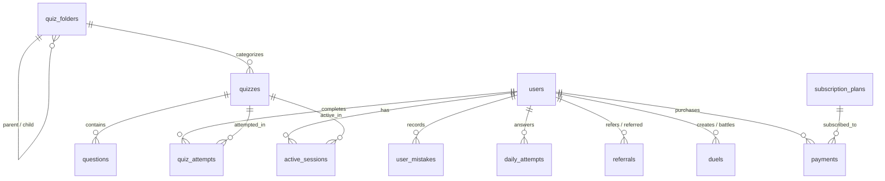

# EXAMPLAYER BOT — DATABASE SCHEMA DOCUMENTATION

**Engine:** PostgreSQL 15+ (Hosted on Supabase)  
**Schema:** `public`  
**Migration Strategy:** Version-controlled SQL scripts (`migrations/`)

---

## 1. Entity Relationship Overview

---

## 2. Table Specifications

### 2.1 `public.users` (Registered Students & Candidates)
Stores Telegram candidate profile information, academic scores, and access tiers.

| Column | Type | Constraints | Description |
|---|---|---|---|
| `id` | `BIGINT` | `PRIMARY KEY` | Telegram numerical User ID |
| `first_name` | `TEXT` | `NOT NULL` | Candidate first name from Telegram |
| `last_name` | `TEXT` | `NULL` | Candidate last name |
| `username` | `TEXT` | `NULL` | Telegram `@handle` (without `@`) |
| `total_score` | `NUMERIC` | `DEFAULT 0` | Cumulative score across all examinations |
| `tests_completed` | `INTEGER` | `DEFAULT 0` | Total tests submitted |
| `streak_days` | `INTEGER` | `DEFAULT 1` | Current continuous daily practice streak |
| `longest_streak` | `INTEGER` | `DEFAULT 1` | Historical max practice streak |
| `referrals_count`| `INTEGER` | `DEFAULT 0` | Number of candidates onboarded |
| `referrer_id` | `BIGINT` | `NULL` | Telegram ID of inviter |
| `duel_rating` | `INTEGER` | `DEFAULT 1200`| ELO rating for 1v1 live duels |
| `duel_wins` | `INTEGER` | `DEFAULT 0` | 1v1 duel victories |
| `duel_losses` | `INTEGER` | `DEFAULT 0` | 1v1 duel defeats |
| `last_daily_date`| `DATE` | `NULL` | Date of last Question-of-the-day attempt |
| `is_active` | `BOOLEAN` | `DEFAULT TRUE` | Account status (`false` = banned/suspended) |
| `is_premium` | `BOOLEAN` | `DEFAULT FALSE`| VIP Scholar Pass access flag |
| `last_active_at` | `TIMESTAMPTZ` | `DEFAULT NOW()`| Last interaction timestamp |
| `created_at` | `TIMESTAMPTZ` | `DEFAULT NOW()`| Account creation timestamp |

**Indexes:**
- `idx_users_score`: `ON public.users (total_score DESC)`
- `idx_users_last_active`: `ON public.users (last_active_at DESC)`

---

### 2.2 `public.quiz_folders` (Hierarchical Examination Categories)
Enables multi-level nesting of folders (e.g. UPSC -> Prelims -> GS Paper 1).

| Column | Type | Constraints | Description |
|---|---|---|---|
| `id` | `UUID` | `PRIMARY KEY DEFAULT gen_random_uuid()` | Unique folder ID |
| `name` | `TEXT` | `NOT NULL` | Folder display name |
| `parent_id` | `UUID` | `REFERENCES quiz_folders(id) ON DELETE CASCADE` | Parent folder ID (`NULL` = root) |
| `order_index` | `INTEGER` | `DEFAULT 0` | Sorting priority |
| `created_at` | `TIMESTAMPTZ` | `DEFAULT NOW()` | Creation timestamp |
| `updated_at` | `TIMESTAMPTZ` | `DEFAULT NOW()` | Last update timestamp |

**Indexes:**
- `idx_folders_parent_id`: `ON public.quiz_folders (parent_id)`

---

### 2.3 `public.quizzes` (Examinations & Mock Tests)
Master examination catalog.

| Column | Type | Constraints | Description |
|---|---|---|---|
| `id` | `UUID` | `PRIMARY KEY DEFAULT gen_random_uuid()` | Unique test paper ID |
| `folder_id` | `UUID` | `REFERENCES quiz_folders(id) ON DELETE SET NULL` | Parent folder association |
| `title` | `TEXT` | `NOT NULL` | Examination title |
| `category` | `TEXT` | `NOT NULL` | Category name (e.g., General Knowledge) |
| `description` | `TEXT` | `NULL` | Detailed syllabus / instructions |
| `total_questions`| `INTEGER` | `DEFAULT 5` | Number of questions in paper |
| `marks_per_question`| `NUMERIC` | `DEFAULT 2.0` | Positive marks for correct answer |
| `negative_marks`| `NUMERIC` | `DEFAULT 0.5` | Penalty deduction for wrong answer |
| `time_limit_seconds`| `INTEGER` | `DEFAULT 30` | Countdown timer per question |
| `is_active` | `BOOLEAN` | `DEFAULT TRUE` | Published status (`false` = draft) |
| `is_premium` | `BOOLEAN` | `DEFAULT FALSE`| Requires VIP Scholar Pass |
| `created_at` | `TIMESTAMPTZ` | `DEFAULT NOW()` | Creation timestamp |

**Indexes:**
- `idx_quizzes_folder_id`: `ON public.quizzes (folder_id)`
- `idx_quizzes_category`: `ON public.quizzes (category)`
- `idx_quizzes_active`: `ON public.quizzes (is_active)`

---

### 2.4 `public.questions` (Exam Question Bank)
Objective multi-choice questions.

| Column | Type | Constraints | Description |
|---|---|---|---|
| `id` | `UUID` | `PRIMARY KEY DEFAULT gen_random_uuid()` | Unique question ID |
| `quiz_id` | `UUID` | `REFERENCES quizzes(id) ON DELETE CASCADE` | Associated quiz paper |
| `question_text` | `TEXT` | `NOT NULL` | The question statement |
| `options` | `JSONB` | `NOT NULL` | Array of 4 option strings |
| `correct_option_index`| `INTEGER` | `NOT NULL` (0 to 3) | 0-based index of correct option |
| `explanation` | `TEXT` | `NULL` | Post-answer explanation text |
| `image_url` | `TEXT` | `NULL` | Optional diagram or question photo URL |
| `order_index` | `INTEGER` | `DEFAULT 0` | Question order within paper |
| `created_at` | `TIMESTAMPTZ` | `DEFAULT NOW()` | Creation timestamp |

**Indexes:**
- `idx_questions_quiz_id`: `ON public.questions (quiz_id)`

---

### 2.5 `public.quiz_attempts` (Completed Exam Results)
Historical log of student submissions.

| Column | Type | Constraints | Description |
|---|---|---|---|
| `id` | `UUID` | `PRIMARY KEY DEFAULT gen_random_uuid()` | Unique attempt submission ID |
| `user_id` | `BIGINT` | `REFERENCES users(id) ON DELETE CASCADE` | Student ID |
| `quiz_id` | `UUID` | `REFERENCES quizzes(id) ON DELETE CASCADE` | Exam ID |
| `total_questions`| `INTEGER` | `NOT NULL` | Total questions presented |
| `correct_count` | `INTEGER` | `DEFAULT 0` | Number of correct responses |
| `wrong_count` | `INTEGER` | `DEFAULT 0` | Number of incorrect responses |
| `skipped_count` | `INTEGER` | `DEFAULT 0` | Unanswered / timed out count |
| `score` | `NUMERIC` | `DEFAULT 0` | Final scaled score with negative marks |
| `accuracy_percent`| `NUMERIC` | `DEFAULT 0` | Accuracy percentage (0-100%) |
| `time_taken_seconds`| `INTEGER`| `DEFAULT 0` | Total duration spent |
| `completed_at` | `TIMESTAMPTZ` | `DEFAULT NOW()` | Submission timestamp |

**Indexes:**
- `idx_attempts_quiz_id`: `ON public.quiz_attempts (quiz_id)`
- `idx_attempts_user_id`: `ON public.quiz_attempts (user_id)`
- `idx_attempts_score`: `ON public.quiz_attempts (score DESC)`
- `idx_attempts_completed_at`: `ON public.quiz_attempts (completed_at DESC)`

---

### 2.6 `public.payments` (Financial Transactions Ledger)
Enterprise payment records and refund history.

| Column | Type | Constraints | Description |
|---|---|---|---|
| `id` | `UUID` | `PRIMARY KEY DEFAULT gen_random_uuid()` | Unique ledger record ID |
| `transaction_id`| `TEXT` | `NOT NULL UNIQUE` | Order / Gateway Transaction Reference |
| `user_id` | `BIGINT` | `REFERENCES users(id) ON DELETE SET NULL` | Student who initiated payment |
| `plan_id` | `TEXT` | `REFERENCES subscription_plans(id) ON DELETE SET NULL` | Purchased plan |
| `amount` | `NUMERIC` | `NOT NULL DEFAULT 0` | Payment amount |
| `currency` | `TEXT` | `NOT NULL DEFAULT 'INR'` | Currency code |
| `gateway` | `TEXT` | `NOT NULL DEFAULT 'UPI'` | Gateway name (UPI, Razorpay, Cashfree, PayU) |
| `status` | `TEXT` | `NOT NULL DEFAULT 'Pending'` | `Success`, `Pending`, `Failed`, `Refunded` |
| `payment_method`| `TEXT` | `NULL` | UPI App, Credit Card, Netbanking |
| `customer_name` | `TEXT` | `NULL` | Payer full name |
| `customer_phone`| `TEXT` | `NULL` | Payer phone number |
| `receipt_url` | `TEXT` | `NULL` | Payment proof or gateway invoice URL |
| `metadata` | `JSONB` | `DEFAULT '{}'::jsonb` | Additional gateway webhook payloads |
| `refund_reason` | `TEXT` | `NULL` | Documented reason if refunded |
| `refunded_at` | `TIMESTAMPTZ` | `NULL` | Refund timestamp |
| `created_at` | `TIMESTAMPTZ` | `DEFAULT NOW()` | Transaction creation timestamp |
| `updated_at` | `TIMESTAMPTZ` | `DEFAULT NOW()` | Last status update timestamp |

**Indexes:**
- `idx_payments_user_id`: `ON public.payments (user_id)`
- `idx_payments_transaction_id`: `ON public.payments (transaction_id)`
- `idx_payments_status`: `ON public.payments (status)`
- `idx_payments_created_at`: `ON public.payments (created_at DESC)`

---

### 2.7 `public.admin_audit_logs` (Security & Governance Audit Trail)
Records every privileged administrative mutation.

| Column | Type | Constraints | Description |
|---|---|---|---|
| `id` | `UUID` | `PRIMARY KEY DEFAULT gen_random_uuid()` | Unique audit log ID |
| `admin_id` | `BIGINT` | `NOT NULL` | Telegram ID of administrator |
| `admin_name` | `TEXT` | `NOT NULL` | Administrator name |
| `action` | `TEXT` | `NOT NULL` | Action code (e.g., `CREATE_QUIZ`, `DELETE_USER`) |
| `target_type` | `TEXT` | `NULL` | Resource category (`QUIZ`, `USER`, `PAYMENT`) |
| `target_id` | `TEXT` | `NULL` | Resource identifier |
| `details` | `JSONB` | `DEFAULT '{}'::jsonb` | Contextual diff / payload |
| `ip_address` | `TEXT` | `NULL` | Originating IP address |
| `created_at` | `TIMESTAMPTZ` | `DEFAULT NOW()` | Event timestamp |

**Indexes:**
- `idx_audit_admin_id`: `ON public.admin_audit_logs (admin_id)`
- `idx_audit_action`: `ON public.admin_audit_logs (action)`
- `idx_audit_created_at`: `ON public.admin_audit_logs (created_at DESC)`

---

### 2.8 `public.broadcast_campaigns` (Announcements & Telemetry)
Keeps historical records of bulk announcements dispatched to students and groups.

| Column | Type | Constraints | Description |
|---|---|---|---|
| `id` | `UUID` | `PRIMARY KEY DEFAULT gen_random_uuid()` | Campaign ID |
| `title` | `TEXT` | `NOT NULL` | Announcement title |
| `message` | `TEXT` | `NOT NULL` | Markdown formatted text content |
| `media_url` | `TEXT` | `NULL` | Image or document URL |
| `buttons` | `JSONB` | `DEFAULT '[]'::jsonb` | Inline button URLs |
| `target` | `TEXT` | `DEFAULT 'all'` | Segment (`all`, `users`, `groups`, `plans`) |
| `target_count` | `INTEGER` | `DEFAULT 0` | Total intended recipients |
| `delivered_count`| `INTEGER` | `DEFAULT 0` | Successfully delivered messages |
| `failed_count` | `INTEGER` | `DEFAULT 0` | Inaccessible chats / blocked count |
| `status` | `TEXT` | `DEFAULT 'Delivered'` | Campaign state |
| `created_by` | `BIGINT` | `NULL` | Admin ID |
| `sent_at` | `TIMESTAMPTZ` | `DEFAULT NOW()` | Dispatch timestamp |
| `created_at` | `TIMESTAMPTZ` | `DEFAULT NOW()` | Creation timestamp |
